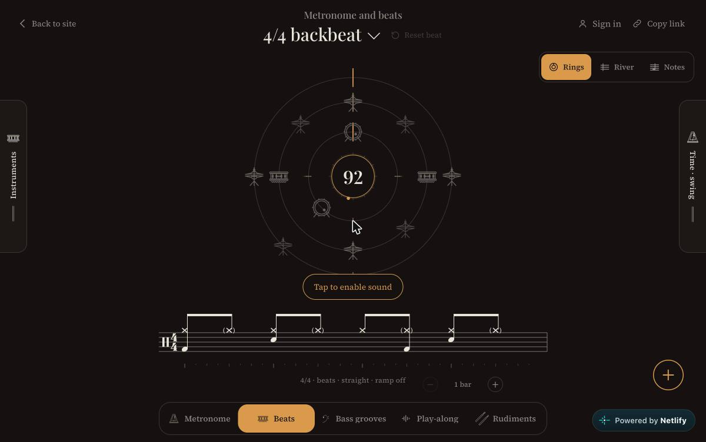

# Drum Metronome & Beats

A metronome and beat design tool for drummers, built by drummer and drum
teacher [Egor Gorkin](https://gorkinegor.com/) in Berlin.

**Try it: <https://gorkinegor.com/beats/>**

## What it does

Runs in the browser:

- a metronome with plenty of controls, including swing;
- design your own groove: place accents on 8th or 16th notes;
- listen to different rhythms and beats;
- play along with the beats;
- practice rudiments.

Bass grooves are for Egor's students and need a sign-in.

## About the author

Egor Gorkin is a drummer and drum teacher, based in Berlin since 2022. He studied
at the Moscow State College of Jazz and Contemporary Music and the Gnessin Russian
Academy of Music. He teaches in Berlin and online.

- Website and lessons: <https://gorkinegor.com/>
- Instagram: <https://www.instagram.com/gorkinegor>

## Status

The tool lives on the website and is not open source. This repository is its
public page. For questions, write via the website.
